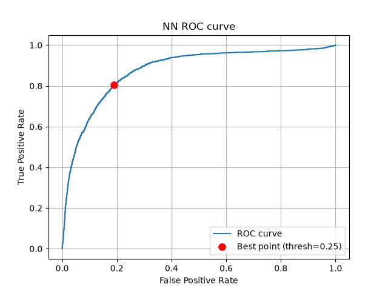
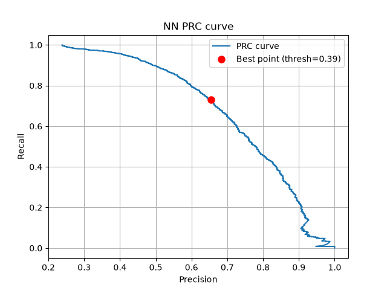
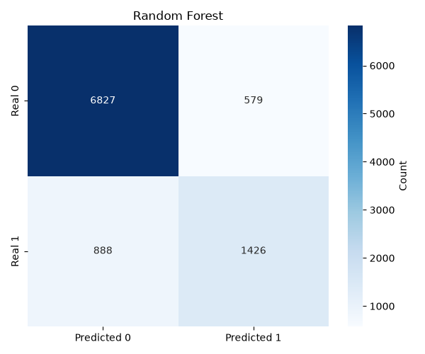
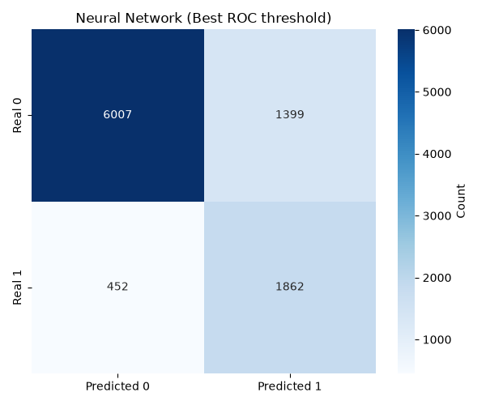
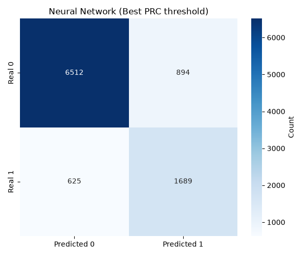

# Task 1 report: Exploratory data analysis

| Field | Value |
| --- | --- |
| Student | Stefano Negri Merlo |
| Dataset | Adult Census Income (`census_income.csv`) |
| Task | 1 |
| Tag / commit | `task1` |
| How to run | `cd part_1 && uv run python scripts/prepare_dataset.py && uv run python run.py` |
| Timebox | 4 h (finished) |

## 1. Summary

I analysed the Adult Census Income dataset (48,598 rows after cleaning, 23.55% above $50K) and built a reproducible pipeline that prepares the data, trains a random forest and a neural network, and exports predictions, ROC/PR curves and confusion matrices. The random forest reaches 85.0% accuracy and 0.664 F1 at a 0.5 cut-off; the neural network reaches 0.896 ROC AUC. Two operating points were selected from the neural network's curves: the ROC point closest to the top-left corner (threshold 0.250, recall 0.829, precision 0.566) and the PR point closest to the top-right corner (threshold 0.362, precision 0.645, recall 0.739, F1 0.689). The main limitation is a single 80/20 holdout.

**Evidence:** `../part_1/src/task1`, `part_1/data/nn_pred.csv`, `part_1/data/nn_roc.csv`, `part_1/data/nn_prc.csv`.

## 2. Goal and success criteria

**Goal.** Task 1 asks for a reproducible analysis of the chosen dataset: load the raw file, describe distributions and target behaviour, find and fix data-quality problems, and present each finding with a labelled chart. I extended the analysis with two predictive baselines (random forest and neural network) and with threshold selection on the neural network's ROC and precision-recall curves, so that the cleaned dataset and the evaluation protocol can be reused in Task 2.

| Criterion | How it is measured | Target | Result |
| --- | --- | --- | --- |
| Reproducible pipeline | Re-run the two commands at the top from the repository root | Predictions and all five plots are regenerated | Passed; rerun completed and reproduced the same metrics |
| Data-quality problems identified and fixed | Row counts, null counts, duplicate and category checks | Every detected issue either fixed or documented | 244 invalid rows removed; duplicate `education-num` dropped after a 1:1 check; 29 duplicates and 2,794–2,804 `?` values documented |
| Two models compared on the same holdout | Accuracy, precision, recall, F1, ROC AUC | Both models above the 76.19% majority-class baseline | RF 85.01%; NN 84.10% at the PR threshold; NN AUC 0.896 |
| Two NN operating points selected from the curves | Explicit criterion in `roc_prc.py` | One ROC point and one PR point with reported metrics | Thresholds 0.250 and 0.362 |
| Labelled figures | Visual inspection and captions with values | Every figure states a claim and a number | Five figures in `part_1/plots` |

**Evidence:** regenerated `part_1/data/*.csv` and `part_1/plots/*.png`; metrics recomputed from the saved predictions with scikit-learn.

## 3. Approach and key decisions

**Main findings.** The target is imbalanced: 11,443 of 48,598 rows are above $50K (23.55%), so predicting the majority class already gives 76.19% accuracy. Income rises sharply with education (Prof-school 71.7%, Doctorate 71.5%, Masters 54.4%, Bachelors 40.8%, HS-grad 15.7%), is much more frequent among married-civil-spouse people (44.1%) than never-married people (4.4%), and among men (29.9%) than women (10.7%). People above $50K are older (44.2 vs 36.9 years), work more hours (45.3 vs 38.8 per week) and more often have a non-zero capital gain (19.6% vs 4.2%). A random forest fitted on all features ranks age (0.236), hours-per-week (0.117), capital-gain (0.101), married-civ-spouse (0.078) and relationship-husband (0.044) as the strongest predictors; `fnlwgt` has essentially no linear relation with the target (correlation −0.006).

| # | Finding | Decision | Alternative considered | Where in the code |
| --- | --- | --- | --- | --- |
| D1 | 244 rows (0.50%) have `capital-gain = 99999`, a sentinel value rather than a real gain; the next largest value is 41,310 | Remove those rows | Impute the gain, cap it, or keep it as an outlier | `part_1/scripts/prepare_dataset.py`, line 17 |
| D2 | `fnlwgt` is a census sampling weight, not a personal attribute, and is uncorrelated with the target | Drop the column | Keep and scale it, or use it as a sample weight | `part_1/scripts/prepare_dataset.py`, lines 24–27 |
| D3 | `education-num` and `education` encode the same 16 levels; the mapping is exactly one-to-one in both directions | Drop `education-num`, keep the more interpretable `education` | Keep the ordinal form, or keep both | `part_1/scripts/prepare_dataset.py`; check in `../part_1/src/task1` |
| D4 | The raw income column has four spellings (`>50K`, `>50K.`, `<=50K`, `<=50K.`) caused by a trailing period | Normalise to a boolean target with `isin([">50K", ">50K."])` | Label encoding without normalisation, which would create four classes | `part_1/scripts/prepare_dataset.py`, line 49 |
| D5 | Eight categorical columns have no natural order, and three contain a `?` placeholder (workclass 5.75%, occupation 5.77%, native-country 1.74%) | One-hot encode all eight columns and keep `?` as its own category | Impute or drop the `?` rows, or use target encoding | `part_1/scripts/prepare_dataset.py`, lines 31–45; yields 106 features |
| D6 | The numeric features are on different scales and capital gain/loss are heavily zero-inflated (median 0, max 41,310) | Trees consume the raw values; the neural network gets a `StandardScaler` inside its pipeline | Quantile or log transforms for every model | `../part_1/src/task1`, lines 14–20 |
| D7 | A single model family could hide model-specific behaviour | Compare a random forest (100 trees) with a neural network on the same split | Logistic regression or gradient boosting as the only baseline | `../part_1/src/task1` |
| D8 | Threshold choice matters more than the ranking itself when the positive class is 23.55% | Train the NN with `MLPRegressor` to obtain a continuous score, then choose the cut-off from the curves | `MLPClassifier` with `predict_proba` and a fixed 0.5 cut-off | `../part_1/src/task1`, lines 14–20; `../part_1/src/task1` |
| D9 | The ROC and PR curves have different goals: the ROC balances both classes, the PR focuses on the positive class | Select the ROC point closest to (0,1) and the PR point closest to (1,1) | Fixed 0.5, maximum F1, or Youden's J | `../part_1/src/task1`, `best_point`; used in `main.py`, lines 66–67 |
| D10 | A single holdout is fast but noisy | Use an 80/20 split with `random_state=42` so the comparison is repeatable | k-fold cross-validation or nested CV | `../part_1/src/task1`, line 31 |
| D11 | Figures and metrics must be reproducible without a notebook | Persist predictions and curves as CSV and plots as PNG | Keep results only in a notebook | `../part_1/src/task1`, lines 41–50 and 60–111 |

**Pipeline:** raw CSV → drop 99999 gains → drop `fnlwgt` and `education-num` → one-hot encode 8 categoricals → boolean target → random-forest feature ranking → 80/20 split → RF and NN → predictions to CSV → ROC/PR and confusion matrices.

**Evidence:** `part_1/scripts/prepare_dataset.py`, `../part_1/src/task1`; statistics recomputed on `datasets/census_income.csv`.

## 4. Results

| Result | Value | Baseline or reference |
| --- | --- | --- |
| Rows after cleaning / positive rate | 48,598 / 23.55% | 48,842 raw rows / 23.93% before removing invalid gains |
| Majority-class accuracy | 76.19% | Always predict `<=50K` |
| RF accuracy / precision / recall / F1 | 85.01% / 71.16% / 62.27% / 0.664 | Majority class; 0.5 cut-off |
| RF balanced accuracy | 0.772 | 0.500 random |
| NN ROC AUC | 0.896 | 0.500 random |
| NN at ROC threshold 0.250: accuracy / precision / recall / F1 | 80.81% / 56.63% / 82.89% / 0.673 | Majority class; 0.5 cut-off (F1 0.658) |
| NN at PR threshold 0.362: accuracy / precision / recall / F1 | 84.10% / 64.54% / 73.85% / 0.689 | Majority class; all-positive F1 0.381 |
| NN balanced accuracy at PR threshold | 0.806 | 0.500 random |

The RF row uses hard 0/1 predictions, so its "AUC" would be a balanced-accuracy value (0.772), not a probability AUC. The NN has a genuine continuous score because it is a regressor. The RF is more precise at 0.5 (71.2% vs 64.5%) but the NN at the PR threshold has higher recall (73.9% vs 62.3%) and a higher F1 (0.689 vs 0.664). The ROC threshold is the high-recall option (82.9% recall, 1,469 false positives); the PR threshold trades 530 fewer false positives for 210 more false negatives.

*Figure 1. Neural-network ROC curve (AUC 0.896); the selected point at threshold 0.250 has FPR 0.198 and TPR 0.829.*

*Figure 2. Neural-network PR curve; the selected point at threshold 0.362 gives precision 0.645 and recall 0.739, against a positive-class baseline of 0.238.*

*Figure 3. Random-forest confusion matrix at 0.5: 1,441 true positives, 584 false positives, 873 false negatives and 6,822 true negatives (recall 0.623, precision 0.712).*

*Figure 4. Neural-network confusion matrix at threshold 0.250: 1,918 true positives and 396 false negatives (recall 0.829), at the cost of 1,469 false positives.*

*Figure 5. Neural-network confusion matrix at threshold 0.362: 1,708 true positives, 939 false positives and 606 false negatives (precision 0.645, recall 0.739, F1 0.689).*

**Evidence:** `part_1/data/rf_pred.csv`, `part_1/data/nn_pred.csv`, `part_1/data/nn_roc.csv`, `part_1/data/nn_prc.csv`; confusion matrices and metrics recomputed from those files; figures 1–5 in `part_1/plots`.

## 5. Problems and how you handled them

| Problem | Cause | What you did | Status |
| --- | --- | --- | --- |
| 244 rows with `capital-gain = 99999` | The value is a missing-value sentinel, not a real capital gain | Removed the rows (0.50% of the data) | Solved |
| `education-num` duplicated `education` | The two columns are two encodings of the same 16 levels | Verified the one-to-one mapping with `check_one_to_one_correspondence`, then dropped `education-num` | Solved |
| Four income labels instead of two | Trailing periods in the source file | Normalised to a boolean target | Solved |
| Class imbalance (23.55% positive) | The dataset over-represents `<=50K` | Reported precision/recall/F1 besides accuracy and selected thresholds; no resampling or class weights | Workaround |
| 2,794–2,804 `?` values in workclass/occupation and 847 in native-country | The source uses `?` instead of an empty field | Kept `?` as its own one-hot category so no rows were lost | Workaround |
| The RF probabilities were not saved | `random_forest_predict` returns `rf.predict`, i.e. hard labels | Compared the RF with accuracy/precision/recall/F1 only; no RF ROC/PR curve | Open |

**Evidence:** the preparation run prints `0.50% rows deleted`; the 1:1 check is in `../part_1/src/task1`; duplicate and `?` counts recomputed on `datasets/census_income.csv`.

## 6. Limitations and trade-offs

| Area | Limitation or trade-off | Impact | Mitigation or next step |
| --- | --- | --- | --- |
| Data | The data is a 1994 US census sample, not a current population | Income levels and feature effects do not transfer to today or to other countries | Treat the model as a historical baseline and document the cohort |
| Data | Removing all 244 `capital-gain = 99999` rows may remove a non-random group | If those rows differ systematically, the estimated income rate is biased | Compare results with a missing-indicator encoding instead of deletion |
| Data | 29 duplicates and 1–6% `?` values remain | Duplicates can inflate the apparent fit; `?` may be informative missingness | Deduplicate and test an explicit missing-value strategy |
| Model | The NN is a regressor, so its scores are not calibrated probabilities (observed range −0.59 to 1.57) | A threshold of 0.362 is not a 36.2% probability of earning more than $50K | Calibrate with isotonic/Platt scaling, or compare `MLPClassifier.predict_proba` |
| Model | Both thresholds were chosen on the same test set used to report the metrics | The reported F1 and recall are optimistic; the selection has no independent confirmation | Nested CV: choose thresholds in an inner fold and report on an outer fold |
| Evaluation | One 80/20 split (9,720 rows, 2,314 positives) with no confidence intervals | Differences such as RF F1 0.664 vs NN F1 0.689 may be within noise | 5-fold or repeated cross-validation with bootstrap intervals |
| Fairness | Sex, race, native-country and marital status are used as predictors; no subgroup metrics were computed | The model may reproduce historical income disparities | Report recall and precision by sex and race before deployment |
| Presentation | The five figures cover model evaluation; the education, marital-status and sex income rates are reported as table values, not as labelled EDA charts | The Task 1 expectation that each finding is backed by a chart is only partly met | Add bar charts for income rate by education, marital status and sex, and a feature-importance chart |
| Operations | No fitted model is persisted; `run.py` retrains and overwrites outputs | Task 2 cannot serve a stable model version without rerunning training | Save the fitted pipelines and metadata with `joblib` |

**Evidence:** `../part_1/src/task1` (regressor, hard RF labels), `../part_1/src/task1` (sort bug, full-data fit), `../part_1/src/task1` (single split, thresholds on test data).

## 7. Next steps

| Priority | Next step | Why | Effort |
| --- | --- | --- | --- |
| 1 | Persist the fitted scaler, NN, RF and feature list with `joblib` | Task 2 needs a reproducible artifact rather than retraining on every start | S |
| 2 | Replace the single split with 5-fold cross-validation and bootstrap confidence intervals | Confirms whether the RF/NN difference and the threshold choice are stable | M |
| 3 | Calibrate the NN scores and evaluate `MLPClassifier` as an alternative | Makes the threshold interpretable as a probability and gives a fair probabilistic baseline | M |
| 4 | Deduplicate, test a missing-value strategy and add class weights | Removes the remaining data-quality issues and may improve minority-class recall | S |
| 5 | Add subgroup precision/recall by sex and race, plus a small test for the cleaning rules | Makes fairness risks visible and protects the pipeline from regressions | M |

## 8. Use of AI assistants

| Tool | What you used it for | Where (files or sections) | How you checked the output |
| --- | --- | --- | --- |
| AI coding assistant | Drafting `check_one_to_one_correspondence` | `../part_1/src/task1` | Checked the 16 education levels and confirmed a 1:1 mapping before dropping `education-num` |
| AI coding assistant | A first threshold-selection helper (discarded) | `part_1/AI_LOG.md`, entry at 09:29 | Replaced it with the explicit distance-to-corner criterion in `roc_prc.py` and checked the selected points against the sklearn curves |
| AI coding assistant | Plotting the ROC/PR curves and saving the confusion matrices | `../part_1/src/task1` | Re-ran the pipeline and inspected the five regenerated PNGs; confusion-matrix counts were recomputed from the prediction CSVs |
| AI coding assistant | Drafting this report | `reports/task1.md` | Recalculated every metric from `part_1/data/*.csv` and cross-checked each claim against the code |

The assistant's first confusion-matrix fix was rejected and rewritten by hand, as recorded in `AI_LOG.md`. The main misleading suggestion was the threshold helper: it did not make the selection criterion explicit, so I could not verify which point it had chosen until I compared it with the manually computed ROC and PR points.

## Checklist

- [x] Task tag pushed and named in the table at the top
- [x] Runs from a fresh clone with the commands above
- [x] No secrets, API keys or large data files committed
- [x] Every section has an Evidence line
- [x] Every figure has a caption with a number
- [x] Guidance blocks and placeholders removed
- [x] `part_1/AI_LOG.md` up to date
